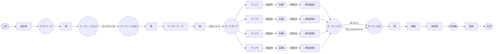

# hi4 基本設計書（第 0 版）

企画は `docs/plan.md`．この文書は，モデルの式，数値解法，構成，検証の計画を決める．細部（定数，アルゴリズムの手順，許容誤差）は，要件が承認された後に仕様書（SPEC，TEST）に書く．

表記：句読点は「，」「．」．圧力は Pa 系，トルクは N·m．内部の計算は SI．定着していない術語は英語のまま．出典は 12 節（リンクはこのセッションでは開いて確かめていない）．

## 0. 記号

| 記号 | 意味 | 単位 |
| :--- | :--- | :--- |
| $t$，$x$ | 時刻，管の軸に沿った座標 | s，m |
| $\theta$ | クランク角（第 1 気筒の圧縮上死点を $0$ とする） | rad（表示は °CA） |
| $A(x)$，$D(x)$ | 管の断面積，水力直径 | m²，m |
| $\rho$，$u$，$p$，$T$ | 密度，流速，圧力，温度 | kg/m³，m/s，Pa，K |
| $Y_k$ | 成分 $k$ の質量分率（$\sum_k Y_k = 1$） | – |
| $e$，$h$ | 比内部エネルギー，比 enthalpy（生成 enthalpy を含む絶対値） | J/kg |
| $E = e + \tfrac12 u^2$，$H = h + \tfrac12 u^2$ | 比全エネルギー，比全 enthalpy | J/kg |
| $R$，$c_p$，$c_v$，$\gamma = c_p/c_v$ | 混合気の気体定数，比熱，比熱比 | J/(kg·K)，– |
| $a = \sqrt{\gamma R T}$ | 音速（組成を凍結したもの） | m/s |
| $f$ | Fanning の摩擦係数（$\tau_w = f\,\tfrac12\rho u \lvert u\rvert$） | – |
| $h_c$ | 壁面の熱伝達率 | W/(m²·K) |
| $T_w$ | 壁温 | K |
| $\dot m$ | 質量流量 | kg/s |
| $C_d$，$A_v$，$A_t = C_d A_v$ | 流量係数，弁やオリフィスの幾何学的な開口面積，有効な面積 | –，m² |
| $V$，$m$ | 容積またはシリンダの体積，その中の気体の質量 | m³，kg |
| $N$，$\omega$ | 機関の回転数，クランク軸の角速度 | rpm，rad/s |
| $N_{tc}$，$\omega_{tc}$，$I_{tc}$ | 過給機の軸の回転数，角速度，慣性モーメント | rpm，rad/s，kg·m² |
| $\pi_c$，$\pi_t$ | コンプレッサの圧力比（出口の全圧／入口の全圧），タービンの膨張比（入口の全圧／出口の静圧） | – |
| $\eta_c$，$\eta_t$，$\eta_m$ | コンプレッサ，タービンの等エントロピー効率，軸の機械効率 | – |
| 添字 $0$ | よどみ点（全）の状態 | |

## 1. 全体の構成

系を，次の 4 種類の部品のネットワークとして表す．

| 部品 | 状態量 | 役割 |
| :--- | :--- | :--- |
| **Pipe**（管） | セルごとの $\rho A$，$\rho u A$，$\rho E A$，$\rho Y_k A$ | 波の伝播．2 節，3 節 |
| **Volume**（容積） | $m$，$mE$，$mY_k$（速度は持たない） | 合流，分岐，室．4 節 |
| **Cylinder**（シリンダ） | $m$，$me$，$mY_k$，液体の燃料の質量，燃焼の進み | 体積が変わる容積と燃焼．6 節 |
| **Connector**（接続の要素） | なし（コンプレッサだけは流量 $\dot m_c$） | 2 つの部品の間の準定常の流れ：管端のオリフィス（弁，スロットル，開放端，閉端），容積の間のオリフィス（ウェイストゲート），コンプレッサ，タービン．5 節，7 節 |

規則：Pipe の両端は必ず Connector を介して Volume，Cylinder，大気のどれかにつながる．Pipe どうしを直接つなぐのは，断面積が連続な場合（1 本の Pipe として扱う）だけにする．こうすると，境界の扱いが「管端 ↔ よどみ状態の容器」の 1 種類にまとまる．

基準の機関のネットワーク：



角の四角は Pipe，丸は Volume，六角は Cylinder，矢印の上の名前は Connector．ランナと排気枝管は，ポート（シリンダヘッドの中の通路）を含む 1 本の Pipe で，断面積が $x$ によって変わる．twin-scroll では，タービン入口の Volume を 2 つ（気筒 1・4 と気筒 2・3）に分ける．

## 2. 管の支配方程式

### 2.1 保存形

断面積 $A(x)$ がゆるやかに変わる管の中の，断面で平均した流れ．成分は $N_s$ 個（2.3 節）．

```math
\frac{\partial}{\partial t}
\begin{pmatrix} \rho A \\ \rho u A \\ \rho E A \\ \rho Y_k A \end{pmatrix}
+ \frac{\partial}{\partial x}
\begin{pmatrix} \rho u A \\ (\rho u^2 + p) A \\ \rho H u A \\ \rho Y_k u A \end{pmatrix}
=
\begin{pmatrix} 0 \\ p\,\dfrac{dA}{dx} - \tau_w P_w \\ q_w P_w \\ 0 \end{pmatrix},
\qquad k = 1, \dots, N_s - 1
```

$P_w = 4A/D$ は濡れ縁の長さ，$\tau_w$ は壁面のせん断応力，$q_w$ は壁から気体への熱流束．導出：長さ $dx$ の検査体積について，質量，運動量，全エネルギーの収支を書く．運動量の式の $p\,dA/dx$ は，傾いた側壁が気体を押す力の $x$ 成分．壁は動かないので，側壁の圧力と摩擦は仕事をせず，エネルギーの式には熱だけが入る．管の中では反応は無い（組成は移流されるだけ）とする．

### 2.2 壁面の摩擦と熱伝達

```math
\tau_w = f\,\frac{1}{2}\rho u \lvert u\rvert, \qquad
q_w = h_c\,(T_w - T)
```

$f$ は Reynolds 数 $Re = \rho \lvert u\rvert D/\mu$ の関数．滑らかな円管では，層流（$Re < 2300$）で $f = 16/Re$，乱流で Blasius の式 $f = 0.0791\,Re^{-1/4}$．粗さと曲がりは，管ごとの倍率で表す．触媒の担体は，開口率を掛けた断面積と，セルの水力直径を持つ管として扱い，層流の $f\,Re$ をセルの形の値（正方形で $14.2$）にする．

熱伝達率は Reynolds–Colburn の相似で摩擦係数から決める．

```math
St = \frac{h_c}{\rho \lvert u\rvert c_p} = \frac{f}{2}\,Pr^{-2/3}
\quad\Longrightarrow\quad
h_c = \frac{f}{2}\,\rho \lvert u\rvert c_p\,Pr^{-2/3}
```

$Pr$ は Prandtl 数．脈動する流れでは定常の式より熱伝達が大きいことが知られているので，管ごとの倍率を設ける．流速が $0$ に近いときの下限（層流の Nusselt 数 $3.66$）を置く．壁温 $T_w$ は，当面は管ごとの設定値とし，後で壁の熱容量の式を加えられるようにする．インタークーラは，水力直径が小さく，壁温が冷却側の温度に等しい管として表す（波が通り抜けることを保つため，効率 $\varepsilon$ を与える 0 次元の要素にはしない）．

### 2.3 組成と熱物性

`ice_2026` の REQ-29 の考え方を引き継ぐ．成分は 4 つ：

| $k$ | 成分 | 備考 |
| :--- | :--- | :--- |
| 1 | 空気（未燃） | |
| 2 | 燃料の蒸気（未燃） | |
| 3 | 既燃ガスのうち空気に由来する質量 | |
| 4 | 既燃ガスのうち燃料に由来する質量 | |

既燃ガスの当量比は $\phi_b = \text{AF}_{st}\,Y_4/Y_3$（$\text{AF}_{st}$ は量論空燃比）で，場所ごとに決まる．既燃ガスを 2 つに分けて運ぶのは，気筒や時刻によって当量比の違う既燃ガスが管の中で混ざるからである．こうすると C，H，O，N の原子の数が，移流と混合で厳密に保存する．

- 状態方程式：$p = \rho R T$，$R = \sum_k Y_k R_k$（既燃ガスの $R$ は $\phi_b$ の関数）．
- 内部エネルギー：$e(T, Y) = \sum_k Y_k e_k(T)$．各成分は熱的に完全な気体（$e_k$ は $T$ だけの関数．NASA の多項式）で，生成 enthalpy を含む絶対値にする．燃焼の発熱は，外から加える項ではなく，未燃の成分が既燃の成分に変わるときの $e$ の差として現れる．
- 管と Volume の中の既燃ガスは，組成を凍結する（温度が低く，解離が無視できる）．筒内の既燃ガスだけは，`ice_2026` と同じ化学平衡（当量比，温度，圧力）にする．排気弁を通るときに凍結の組成へ移す（その差の扱いは仕様で決める．11 節の未決 3）．
- 保存量から温度を求める：$e = E - \tfrac12 u^2$ を与えて $e(T, Y) = e$ を $T$ について Newton 法で解く（$\partial e/\partial T = c_v > 0$ なので単調）．

音速は，組成を凍結した値 $a = \sqrt{\gamma R T}$，$\gamma = c_p(T,Y)/c_v(T,Y)$．

## 3. 管の数値解法

### 3.1 離散化（有限体積法）

管を長さ $\Delta x_i$ のセルに分ける．セル $i$ の体積を $\mathcal V_i = \int A\,dx$，面 $i \pm \tfrac12$ の断面積を $A_{i\pm 1/2}$，セルの平均を $U_i = (\rho, \rho u, \rho E, \rho Y_k)_i$ とする．

```math
\mathcal V_i \frac{dU_i}{dt}
= -\left( A_{i+1/2}\,\hat F_{i+1/2} - A_{i-1/2}\,\hat F_{i-1/2} \right)
+ \begin{pmatrix} 0 \\ p_i\,(A_{i+1/2} - A_{i-1/2}) \\ 0 \\ 0 \end{pmatrix}
+ \mathcal V_i\,S_i
```

$\hat F$ は面の数値流束（単位面積あたり：$(\rho u,\ \rho u^2 + p,\ \rho H u,\ \rho Y_k u)$ の近似），$S_i$ は摩擦と熱伝達の項を体積あたりに直したもの．

**静止の保持（well-balanced）**：$u = 0$，$p$ が一様なとき，数値流束は $\hat F = (0, p, 0, 0)$ となり，運動量の式の右辺は $-p\,(A_{i+1/2} - A_{i-1/2}) + p_i\,(A_{i+1/2} - A_{i-1/2}) = 0$．断面積が変わる管でも，静止した気体が動き出さない．断面積の項をこの形にするのはそのためで，10 節の検査 3 で確かめる．

### 3.2 数値流束と再構成

- **数値流束**：HLLC（Toro ほか 1994）．波の速さの見積もりと，左右の状態の圧力・エネルギーだけを使うので，比熱が温度で変わる気体にそのまま使える．接触不連続（温度と組成の境目）を保つので，新気と既燃ガスの境目がぼやけにくい．
- **再構成**：原始変数 $(\rho, u, p, Y_k)$ の区分線形（MUSCL．van Leer 1979）．勾配の制限は minmod を既定，van Albada を選択肢とする．$Y_k$ は $[0,1]$ と $\sum_k Y_k = 1$ を保つように制限する．
- **時間積分**：3 段 3 次の SSP Runge–Kutta（Gottlieb ほか 2001）を既定，MUSCL–Hancock（1 ステップにつき流束 1 回）を速さのための選択肢とする．摩擦と熱伝達の項は，管の寸法では硬くないので陽に扱う（触媒のように水力直径が小さい管で硬くなる場合は，その項だけ陰に解く）．
- **時間の刻み**：系の全体で 1 つ．

```math
\Delta t = \text{CFL} \times \min_i \frac{\Delta x_i}{\lvert u_i\rvert + a_i}, \qquad \text{CFL} \le 0.8
```

Volume，Cylinder，過給機の軸，クランク軸も同じ $\Delta t$ で，同じ Runge–Kutta の段の中で進める．こうすると，面を通った質量とエネルギーが，両側の部品で同じ値になる（4.2 節）．

- **格子**：$\Delta x$ は管ごとに設定する（既定は $10\ \text{mm}$．ランナと排気枝管は $5\ \text{mm}$ も選べる）．結果が格子によらないことは，$\Delta x$ を半分にして確かめる（10 節の検査 14）．

### 3.3 正値の保持

弁が開く瞬間の強い膨張で，再構成した値の密度や圧力が負にならないように，負になる面では再構成を 1 次に落とす．それでもセルの値が負になったときは，計算を止めて場所と状態を報告する（値を黙って丸めない）．

## 4. 容積（Volume）

### 4.1 式

速度を持たない（流れ込んだ運動エネルギーは内部エネルギーになる）．つながっている面 $j$ の，Volume へ入る向きの質量流量を $\dot m_j$，その全 enthalpy を $H_j$，組成を $Y_{k,j}$ とする．

```math
\frac{dm}{dt} = \sum_j \dot m_j, \qquad
\frac{d(m e)}{dt} = \sum_j \dot m_j H_j + \dot Q_w, \qquad
\frac{d(m Y_k)}{dt} = \sum_j \dot m_j Y_{k,j}
```

$\dot Q_w = h_c A_w (T_w - T)$ は壁からの熱．出ていく面では $H_j$ と $Y_{k,j}$ は Volume の値，入ってくる面では面の向こう側の値（風上）．

### 4.2 保存

管端の面の流束 $A\hat F$（質量，全 enthalpy，組成の成分）を，そのまま Volume の式の $\dot m_j$，$\dot m_j H_j$，$\dot m_j Y_{k,j}$ に使う．同じ数を管のセルから引き，Volume に足すので，系の全体の質量，エネルギー，各成分の質量が，丸め誤差の範囲で保存する（10 節の検査 9）．

### 4.3 合流部の割り切りと，寸法の制限

合流部（排気の集合部，分岐）を Volume で表すと，流れ込んだ運動量の向きの情報が失われる．定常の流れでは動圧 1 つ分の全圧の損失に相当し，急拡大の損失には近いが，なめらかな合流では損失を大きく見積もる．また，pulse converter のように運動量の向きを使う形は表せない．向きによる損失の係数を持つ合流部のモデル（Bassett ほか 2003）は拡張とする．

Volume が小さすぎると，陽な時間積分が不安定になる．つながる管の断面積の和を $\sum A_j$ として，$V \ge \sum_j A_j\,\Delta x_j$（つながるセルの体積の和）を下限にする．これより小さい室は，隣の管に含める．

## 5. 接続の要素（Connector）

### 5.1 圧縮性のオリフィス（容積と容積の間）

上流のよどみ状態を $(p_0, T_0)$，下流の静圧を $p_d$，有効な面積を $A_t$ とする．上流から喉までを等エントロピー，喉の圧力を下流の圧力に等しいとする．$\gamma$ は上流の気体の値．

```math
\dot m = A_t\,\frac{p_0}{\sqrt{R T_0}}\;\Psi\!\left(\frac{p_d}{p_0}\right),
\qquad
\Psi(r) =
\begin{cases}
\sqrt{\dfrac{2\gamma}{\gamma - 1}\left(r^{2/\gamma} - r^{(\gamma+1)/\gamma}\right)} & r > r_c \\[2ex]
\sqrt{\gamma}\left(\dfrac{2}{\gamma+1}\right)^{\frac{\gamma+1}{2(\gamma-1)}} & r \le r_c
\end{cases},
\qquad
r_c = \left(\frac{2}{\gamma+1}\right)^{\frac{\gamma}{\gamma-1}}
```

導出：エネルギーの式 $c_p T_0 = c_p T_t + \tfrac12 u_t^2$ と等エントロピーの関係 $T_t/T_0 = r^{(\gamma-1)/\gamma}$，$\rho_t/\rho_0 = r^{1/\gamma}$ から $u_t = \sqrt{\tfrac{2\gamma}{\gamma-1} R T_0\,(1 - r^{(\gamma-1)/\gamma})}$．$\dot m = \rho_t u_t A_t$ に代入して整理すると上の式になる．$r \le r_c$ では喉が音速（チョーク）で，流量は下流の圧力によらない．`ice_2026` の SPEC-04 と同じ式．ウェイストゲートに使う．

### 5.2 管端のオリフィス（管と，容積・シリンダ・大気の間）

弁，スロットル，開放端，閉端を，同じ 1 つの問題として解く．管端の状態 $b$（$\rho_b, u_b, p_b$）を求め，その物理的な流束を管端の面の流束に使う．

設定：管の内側の，端のセルの状態を $i$．$u$ は端へ向かう向きを正とする．容器の側はよどみ状態 $(p_0, \rho_0, a_0)$．有効な面積 $A_t = C_d A_v$，管の断面積 $A_p$，$\psi = A_t/A_p$．以下は，端の近くで $\gamma$ を一定とした式で書く（実装では，上流の気体の $\gamma$ を端で凍結して使う．エネルギーの関係は $h(T)$ で評価する）．完全気体では $h = a^2/(\gamma - 1)$．

管の内側から端に届く特性曲線（$dx/dt = u + a$）の上で，Riemann 不変量が保たれる：

```math
u_b + \frac{2 a_b}{\gamma - 1} = u_i + \frac{2 a_i}{\gamma - 1} \tag{5.1}
```

**(a) 管から容器へ流れ出るとき（$u_b > 0$）**．未知数は端 $b$ と喉 $t$ の $(\rho, u, p)$ の 6 つ．

1. 式 (5.1)．
2. 端の気体は管の内側から来るので，エントロピーは内側の値：$p_b/\rho_b^{\gamma} = p_i/\rho_i^{\gamma}$．
3. 端から喉まで等エントロピー：$p_t/\rho_t^{\gamma} = p_b/\rho_b^{\gamma}$．
4. エネルギー：$\dfrac{a_b^2}{\gamma-1} + \dfrac{u_b^2}{2} = \dfrac{a_t^2}{\gamma-1} + \dfrac{u_t^2}{2}$．
5. 質量：$\rho_b u_b A_p = \rho_t u_t A_t$．
6. 喉の条件：亜音速なら $p_t = p_0$．$u_t$ が $a_t$ に達したら，これを $u_t = a_t$ に替える（チョーク）．

**(b) 容器から管へ流れ込むとき（$u_b < 0$）**．未知数は同じ 6 つ．

1. 式 (5.1)．
2. 容器から喉まで等エントロピー：$p_t/\rho_t^{\gamma} = p_0/\rho_0^{\gamma}$．
3. エネルギー（喉）：$\dfrac{a_0^2}{\gamma-1} = \dfrac{a_t^2}{\gamma-1} + \dfrac{u_t^2}{2}$．
4. エネルギー（端）：$\dfrac{a_0^2}{\gamma-1} = \dfrac{a_b^2}{\gamma-1} + \dfrac{u_b^2}{2}$．
5. 質量：$\rho_t u_t A_t = \rho_b \lvert u_b\rvert A_p$．
6. 喉から端まで：噴流は一定の圧力で広がって運動エネルギーを失うとし，$p_b = p_t$（定圧モデル．Benson 1982）．喉がチョークしたら，これを $u_t = a_t$ に替える．

どちらも，1 つの未知数（たとえば $p_b$）の方程式に落として解く．極限：$\psi = 0$ では $u_b = 0$ で，式 (5.1) が $a_b$ を決める（閉端．波は同じ符号で反射する）．$\psi = 1$ で容器が大気なら $p_b = p_0$（開放端．波は逆の符号で反射する）．部分的に開いた弁はその間になる．この 2 つの極限と，定常の流れで 5.1 節の流量に一致することを検査する（10 節の検査 7，8）．

組成は風上の値（流れ出るときは管の端のセル，流れ込むときは容器）．管端が超音速で流れ出るときは，内側の状態をそのまま使う．

**スロットル**は，管 P4 の端とサージタンクの間のこの要素で，$A_v$ を開度の関数にする．**大気への開放端**は，$\psi = 1$（または端の形による $C_d$）で容器を大気にしたもの．

### 5.3 弁の開口面積

吸気弁と排気弁の揚程 $L_v(\theta)$ と，揚程と弁の径から決まる幾何学的な面積 $A_v$，流量係数 $C_d(L_v/d_v)$ は `ice_2026` の SPEC-03 を引き継ぐ．可変バルブタイミングは，揚程の曲線の位相をずらす．4 弁は，同じ動きの 2 弁を 1 つの面積にまとめる．

## 6. シリンダ

### 6.1 式

`ice_2026` の筒内モデル（0 次元，単一ゾーン，開いた系の第一法則）を，4 本に並べる．気筒 $n$ のクランク角は，点火の順序 1–3–4–2 に合わせて $\theta_n = \theta - \Delta_n$，$(\Delta_1, \Delta_2, \Delta_3, \Delta_4) = (0, 540, 180, 360)^\circ$CA．

```math
\frac{dm}{dt} = \sum_{v} \dot m_v + \dot m_{ev}, \qquad
\frac{d(m e)}{dt} = -p\,\frac{dV}{dt} + \sum_{v} \dot m_v H_v + \dot m_{ev}\,h_{f,l} - \dot Q_w
```

$v$ は弁（管端の面．シリンダへ入る向きを正），$\dot m_{ev}$ は液体の燃料が気化する速さ，$h_{f,l}$ は液体の燃料の比 enthalpy（蒸気の値から蒸発潜熱を引いたもの），$\dot Q_w$ は壁への熱（Woschni 1967）．$e$ が生成 enthalpy を含むので，燃焼の発熱の項は無い．

組成：燃焼は，未燃の空気と燃料の蒸気を，既燃の成分（2.3 節の $k = 3, 4$）へ移す．燃えた割合 $x_b$ は Wiebe 関数

```math
x_b(\theta) = 1 - \exp\!\left[-a_W \left(\frac{\theta - \theta_s}{\Delta\theta_b}\right)^{m_W + 1}\right]
```

（$\theta_s$ は燃焼の始まり，$\Delta\theta_b$ は燃焼の期間，$a_W$，$m_W$ は形の定数）．期間を乱流火炎の伝播の速さに連動させる方法は `ice_2026` の SPEC-07 を引き継ぐ．過給による筒内の密度と残留ガスの割合の変化が，この連動を通して燃焼の期間に効く．

### 6.2 直噴

燃料は，噴射の始まりのクランク角と噴射率で，液体としてシリンダに入る．液体の質量 $m_{f,l}$ を状態量に持ち，$\dot m_{ev} = m_{f,l}/\tau_{ev}$ で気化する（$\tau_{ev}$ は時定数）．蒸発潜熱は筒内の気体から奪われる（上の式の $h_{f,l}$）．吸気弁が開いている間に気化すれば，筒内の温度が下がって体積効率が上がり，ノックにも効く．吸気管には燃料が無いので，overlap の間に排気側へ吹き抜ける気体は空気だけになる（scavenging）．`ice_2026` の REQ-30 を引き継ぐ．

### 6.3 ノックの指標

過給機関では点火時期がノックで制限されるので，指標を持つ．未燃部の温度 $T_u$ を，点火の時点の筒内の状態からの等エントロピー圧縮（$p$ は筒内圧）で求め，Livengood–Wu の積分

```math
I_K(t) = \int_{t_{IVC}}^{t} \frac{dt'}{\tau_{ig}\big(p(t'), T_u(t')\big)}
```

が，燃焼の終わりより前に $1$ に達したらノックとする．自着火の遅れ $\tau_{ig}$ は Douaud と Eyzat（1978）の式の形 $\tau_{ig} = C\,p^{-n} \exp(B/T_u)$．点火時期の制御は，MBT とノックの限界のうち遅い方を選ぶ．

### 6.4 回転系

```math
I\,\frac{d\omega}{dt} = \sum_{n=1}^{4} T_{g,n}(\theta_n) + T_{in}(\theta, \omega) - T_f - T_L
```

$T_{g,n}$ は気筒 $n$ のガス圧によるトルク，$T_{in}$ は往復質量の慣性によるトルク，$T_f$ は摩擦，$T_L$ は動力計の吸収トルク．脈動を調べる用途では，回転数を一定に保つ運転（$\omega$ を与える）を基本にし，過渡（加速，ターボラグ）ではこの式を解く．

## 7. 過給機

コンプレッサとタービンは，脈動の周期に比べて内部の通過の時間が短いとして，準定常の特性で表す（脈動する流れの下でのタービンの効率が準定常の値からずれることは知られているが，当面は扱わない．限界として文書に書く）．特性は，公開されている式による map で与える（Jensen ほか 1991，Moraal と Kolmanovsky 1999，Eriksson と Nielsen 2014 に整理されている形から選ぶ．選び方は仕様で決める）．

### 7.1 コンプレッサ

修正流量と修正回転数：

```math
\dot m_{corr} = \dot m_c\,\frac{\sqrt{T_{01}/T_{ref}}}{p_{01}/p_{ref}}, \qquad
N_{corr} = \frac{N_{tc}}{\sqrt{T_{01}/T_{ref}}}
```

（$p_{01}$，$T_{01}$ は入口の Volume の状態，$p_{ref}$，$T_{ref}$ は map の基準の状態）．map は $\pi_c = \Pi_c(\dot m_{corr}, N_{corr})$，$\eta_c = \mathrm{H}_c(\dot m_{corr}, N_{corr})$．

回転数が一定の線は，サージの近くで $\pi_c$ が流量の単調な関数でなくなるので，「圧力比から流量を求める」ことができない．そこで，コンプレッサを通る流量 $\dot m_c$ を状態量にし，コンプレッサの中の気体の柱（等価な長さ $L_c$，断面積 $A_c$）の運動方程式を解く（Greitzer 1976 の形）．

```math
\frac{L_c}{A_c}\,\frac{d\dot m_c}{dt} = p_{01}\,\Pi_c(\dot m_{corr}, N_{corr}) - p_{2}
```

$p_2$ は出口の Volume の圧力．定常では $p_2 = p_{01}\Pi_c$ になる．サージ（流量の振動と逆流）は，この式と下流の容積から自然に現れる（逆流の側の $\Pi_c$ の形は仕様で決める）．

出口の全温度と，コンプレッサが要する動力：

```math
T_{02} = T_{01}\left[1 + \frac{\pi_c^{(\gamma-1)/\gamma} - 1}{\eta_c}\right], \qquad
P_c = \dot m_c\,\big(h(T_{02}) - h(T_{01})\big)
```

導出：等エントロピーの圧縮では $T_{02s}/T_{01} = \pi_c^{(\gamma-1)/\gamma}$．効率の定義 $\eta_c = (h_{02s} - h_{01})/(h_{02} - h_{01})$ から，比熱が一定なら上の式になる．

### 7.2 タービンとウェイストゲート

タービンは，入口の Volume（全圧 $p_{03}$，全温度 $T_{03}$）と出口の Volume（静圧 $p_4$）の間の要素．膨張比 $\pi_t = p_{03}/p_4$ に対して流量は単調なので，オリフィスと同じに扱える．

```math
\dot m_t = \frac{p_{03}/p_{ref}}{\sqrt{T_{03}/T_{ref}}}\;\Phi_t(\pi_t, N_{corr,t}), \qquad
P_t = \eta_t\,\dot m_t\,c_p T_{03}\left[1 - \pi_t^{-(\gamma-1)/\gamma}\right]
```

効率は速度比 $U/C_s$ の関数 $\eta_t = \mathrm{H}_t(U/C_s)$．$U = \tfrac12 D_t\,\omega_{tc}$ は翼の先端の周速（$D_t$ はタービンの翼車の径），$C_s = \sqrt{2 c_p T_{03}\left[1 - \pi_t^{-(\gamma-1)/\gamma}\right]}$ は等エントロピーの膨張で得られる速度．出口の Volume へ入る全 enthalpy は $H_{03} - P_t/\dot m_t$．

脈動する流れでは，$\pi_t$ と $\dot m_t$ が 1 サイクルの中で大きく変わり，$P_t$ の瞬時値の大半は blowdown の山で生じる．これを瞬時値のまま積分するのが，この設計の要点の 1 つである．

ウェイストゲートは，同じ 2 つの Volume の間の 5.1 節のオリフィスで，面積を制御する．twin-scroll では，入口の Volume を 2 つにし，それぞれからタービンへ半分の流路で流れるとする（部分的な流入の特性は近似．拡張）．

### 7.3 軸

```math
I_{tc}\,\omega_{tc}\,\frac{d\omega_{tc}}{dt} = \eta_m P_t - P_c
```

定常の運転点を求めるときは，$I_{tc}$ を小さくして収束を早める（周期定常の解の平均は $I_{tc}$ によらない．1 サイクルの中の回転数の変動だけが変わる）．過渡の計算では本来の値に戻す．

## 8. 制御と運転

| 制御 | 入力 | 操作量 |
| :--- | :--- | :--- |
| 負荷 | 目標のトルクまたはアクセル開度 | スロットル開度，目標の過給圧 |
| 過給圧 | サージタンクの圧力（1 サイクルの平均） | ウェイストゲートの面積（PI 制御） |
| 空燃比 | 吸気弁が閉じた時点の筒内の空気の質量（気筒ごと） | 噴射量（目標の当量比） |
| 点火時期 | MBT の探索と，ノックの指標 | 点火時期 |
| バルブタイミング | 回転数と負荷の表 | 吸気と排気のカムの位相 |

運転の種類：(1) 回転数一定の定常点（周期定常まで計算する．収束の判定は，気筒ごとの IMEP，体積効率，過給機の回転数の 1 サイクルごとの変化），(2) 回転数の掃引（全負荷の性能曲線），(3) 回転数と負荷のマップ，(4) 過渡（スロットルを急に開く，急に閉じる）．

## 9. 脈動の表示

1. **$x$–$t$ 線図**：系統図の上で選んだ経路（たとえば，サージタンク → ランナ 1 → 気筒 1 → 排気枝管 1 → タービン入口）に沿った $p(x, \theta)$ を，横軸 $x$，縦軸 $\theta$ の色の図にする．弁の開閉の時期を線で重ねる．波の伝播と反射が斜めの筋として見える．
2. **プローブの波形**：任意の位置の $p$，$u$，$T$，$\dot m$，既燃ガスの割合を，クランク角に対して描く．気筒ごとに位相をそろえて重ねる．筒内圧，弁の揚程，弁の流量（逆流を含む）と並べる．
3. **波の分解**：1 サイクルの平均 $(\bar p, \bar u, \bar\rho, \bar a)$ のまわりの線形の音響として，右向きと左向きの成分に分ける．

```math
p^{\pm} = \frac{1}{2}\Big[(p - \bar p) \pm \bar\rho\,\bar a\,(u - \bar u)\Big]
```

導出：線形化した 1 次元の音響では，右向きの波で $p' = \bar\rho\bar a\,u'$，左向きの波で $p' = -\bar\rho\bar a\,u'$．$p' = p^+ + p^-$，$\bar\rho\bar a\,u' = p^+ - p^-$ を解く．振幅が大きい排気では近似だが，どちらから来た波が弁に届いているかが分かる．
4. **系統図のアニメーション**：管を $p$，$u$，$T$，既燃ガスの割合のどれかで色づけし，クランク角を進める．
5. **回転次数の分析**：プローブの圧力の 1 サイクルを Fourier 級数にし，次数ごとの振幅を示す（4 気筒では点火の周波数が回転の 2 次）．
6. **気筒ごとの指標**：体積効率，残留ガスの割合，scavenging で吹き抜けた空気の質量，IMEP．
7. **過給機**：コンプレッサとタービンの map の上の，1 サイクルの作動点の軌跡．

## 10. 検証の計画

解析解または厳密な性質と比べる検査を，実装より先に作る（許容誤差は仕様で決める）．

| 番号 | 検査 | 比べる相手 |
| :--- | :--- | :--- |
| 1 | 衝撃波管（Sod 1978 の条件，および排気の blowdown に近い圧力比と温度比） | Riemann 問題の厳密解 |
| 2 | なめらかな等エントロピーの波の伝播で，格子を細かくしたときの誤差の減り方 | 特性曲線による解．$L^1$ の誤差が 2 次で減る |
| 3 | 断面積が変わる管の中の静止した気体 | 静止のまま（丸め誤差の範囲） |
| 4 | 先細末広ノズルの定常の等エントロピーの流れ | 面積と Mach 数の関係 |
| 5 | 摩擦のある一定断面の管の定常の流れ | Fanno の流れ |
| 6 | 加熱のある一定断面の管の定常の流れ | Rayleigh の流れ |
| 7 | 管の共鳴：両端が閉じた管，一端が開いた管 | $f_n = n\,a/(2L)$，$f_n = (2n-1)\,a/(4L)$（開放端の補正を除く） |
| 8 | 管端のオリフィスの定常の流量（亜音速，チョーク，逆向き）と，$\psi = 0$，$\psi = 1$ の極限の反射 | 5.1 節の式，閉端と開放端の反射 |
| 9 | 閉じた系（管，容積，合流部）の質量，エネルギー，成分の保存 | 丸め誤差の範囲で一定 |
| 10 | 容積と管の Helmholtz 共鳴 | $\omega_H = a\sqrt{A/(V L)}$（管の中の質量による補正を含めて比べる） |
| 11 | 接触不連続（温度と組成の境目）の移流 | 圧力と流速に乱れが出ない．成分の質量の保存 |
| 12 | シリンダ：弁が閉じた区間の断熱の圧縮と膨張，1 サイクルの第一法則の残差 | `ice_2026` の TEST-09，TEST-29 と同じ判定 |
| 13 | 4 気筒の対称性：形が同じ気筒の波形が，位相をずらすと一致する | 一致（対称な配管のとき） |
| 14 | 格子の収束：$\Delta x$ を半分にしたときの体積効率と IMEP の変化 | 変化が許容の範囲 |
| 15 | 体積効率の回転数に対する山が，ランナを長くすると低回転へ動く | 定性的な性質（`ice_2026` の REQ-25 と同じ） |
| 16 | 過給機：定常で $\eta_m P_t = P_c$，コンプレッサの出口温度，map の補間 | 式 |
| 17 | コンプレッサ：下流を絞ると，流量の振動（サージ）が現れる | 定性的な性質 |
| 18 | 管を 1 セルにした極限で，0 次元の結果に近づく | `ice_2026`（単気筒，自然吸気の設定） |

系の全体の保存量の収支（質量，エネルギー，C・H・O・N の原子）は，運転中も常に積算して，残差を表示する．

## 11. 未決の事項

1. 実装の形（企画書 5 節）と，それに伴うコードの構成．
2. 管端の問題（5.2 節）を，比熱が温度で変わる気体で厳密に解くか，端で $\gamma$ を凍結するか．凍結した場合の誤差を検査 1，8 で測って決める．
3. 筒内の化学平衡の既燃ガスを，排気弁を通るときに凍結の組成へ移すときのエネルギーの扱い（生成 enthalpy を含む絶対値で全 enthalpy を保てば，温度が決まる）．
4. リッチ（$\phi > 1$）の既燃ガスの，管の中での凍結の組成（CO，H₂ を含む）の表の作り方．
5. 過給機の map の式の選択と，基準の機関に合わせた寸法．
6. 合流部の圧力損失のモデルを，どの段階で入れるか．
7. 管の壁温（設定値か，壁の熱容量の式か）．排気温度とタービンの仕事に効く．

## 12. 出典

リンクは書誌の情報から書いたもので，このセッションでは開いて確かめていない．

- J. B. Heywood, *Internal Combustion Engine Fundamentals*, 2nd ed., McGraw-Hill, 2018．（ガス交換，過給，燃焼，熱伝達の全般）
- R. S. Benson, *The Thermodynamics and Gas Dynamics of Internal-Combustion Engines*, Vol. I, Clarendon Press, 1982．（管端の境界条件，定圧モデル）
- D. E. Winterbone, R. J. Pearson, *Theory of Engine Manifold Design: Wave Action Methods for IC Engines*, Professional Engineering Publishing, 2000．
- E. F. Toro, *Riemann Solvers and Numerical Methods for Fluid Dynamics*, 3rd ed., Springer, 2009．<https://doi.org/10.1007/b79761>
- E. F. Toro, M. Spruce, W. Speares, "Restoration of the contact surface in the HLL-Riemann solver", *Shock Waves* 4 (1994) 25–34．<https://doi.org/10.1007/BF01414629>
- B. van Leer, "Towards the ultimate conservative difference scheme. V", *J. Comput. Phys.* 32 (1979) 101–136．<https://doi.org/10.1016/0021-9991(79)90145-1>
- S. Gottlieb, C.-W. Shu, E. Tadmor, "Strong stability-preserving high-order time discretization methods", *SIAM Review* 43 (2001) 89–112．<https://doi.org/10.1137/S003614450036757X>
- G. A. Sod, "A survey of several finite difference methods for systems of nonlinear hyperbolic conservation laws", *J. Comput. Phys.* 27 (1978) 1–31．<https://doi.org/10.1016/0021-9991(78)90023-2>
- B. J. McBride, M. J. Zehe, S. Gordon, "NASA Glenn Coefficients for Calculating Thermodynamic Properties of Individual Species", NASA/TP-2002-211556, 2002．
- G. Woschni, "A universally applicable equation for the instantaneous heat transfer coefficient in the internal combustion engine", SAE Technical Paper 670931, 1967．<https://doi.org/10.4271/670931>
- J. C. Livengood, P. C. Wu, "Correlation of autoignition phenomena in internal combustion engines and rapid compression machines", *Symp. (Int.) Combust.* 5 (1955) 347–356．<https://doi.org/10.1016/S0082-0784(55)80047-1>
- A. M. Douaud, P. Eyzat, "Four-octane-number method for predicting the anti-knock behavior of fuels and engines", SAE Technical Paper 780080, 1978．<https://doi.org/10.4271/780080>
- E. M. Greitzer, "Surge and rotating stall in axial flow compressors. Part I: Theoretical compression system model", *J. Eng. Power* 98 (1976) 190–198．<https://doi.org/10.1115/1.3446138>
- J.-P. Jensen, A. F. Kristensen, S. C. Sorenson, N. Houbak, E. Hendricks, "Mean value modeling of a small turbocharged diesel engine", SAE Technical Paper 910070, 1991．<https://doi.org/10.4271/910070>
- P. Moraal, I. Kolmanovsky, "Turbocharger modeling for automotive control applications", SAE Technical Paper 1999-01-0908, 1999．<https://doi.org/10.4271/1999-01-0908>
- L. Eriksson, L. Nielsen, *Modeling and Control of Engines and Drivelines*, Wiley, 2014．<https://doi.org/10.1002/9781118536186>
- M. D. Bassett, R. J. Pearson, N. P. Fleming, D. E. Winterbone, "A multi-pipe junction model for one-dimensional gas-dynamic simulations", SAE Technical Paper 2003-01-0370, 2003．<https://doi.org/10.4271/2003-01-0370>
