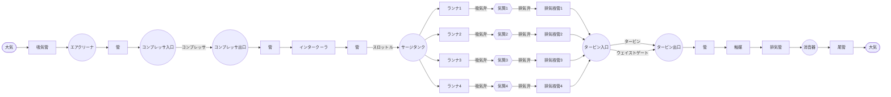

# D-01：全体の構成（ネットワークの部品）

系を，次の 4 種類の部品のネットワークとして表す．

| 部品 | 状態量 | 役割 |
| :--- | :--- | :--- |
| **Pipe**（管） | セルごとの $\rho A$，$\rho u A$，$\rho E A$，$\rho Y_k A$ | 波の伝播．D-02〜D-04，D-05，D-06 |
| **Volume**（容積） | $m$，$mE$，$mY_k$（速度は持たない） | 合流，分岐，室．D-07 |
| **Cylinder**（シリンダ） | $m$，$me$，$mY_k$，液体の燃料の質量，燃焼の進み | 体積が変わる容積と燃焼．D-11〜D-14 |
| **Connector**（接続の要素） | なし（コンプレッサだけは流量 $\dot m_c$） | 2 つの部品の間の準定常の流れ：管端のオリフィス（弁，スロットル，開放端，閉端），容積の間のオリフィス（ウェイストゲート），コンプレッサ，タービン．D-08〜D-10，D-15〜D-17 |

規則：Pipe の両端は必ず Connector を介して Volume，Cylinder，大気のどれかにつながる．Pipe どうしを直接つなぐのは，断面積が連続な場合（1 本の Pipe として扱う）だけにする．こうすると，境界の扱いが「管端 ↔ よどみ状態の容器」の 1 種類にまとまる．

現象（P-nn）を全部採った場合のネットワーク（採らない部品は置かない）：

角の四角は Pipe，丸は Volume，六角は Cylinder，矢印の上の名前は Connector．ランナと排気枝管は，ポート（シリンダヘッドの中の通路）を含む 1 本の Pipe で，断面積が $x$ によって変わる．twin-scroll では，タービン入口の Volume を 2 つ（気筒 1・4 と気筒 2・3）に分ける．
